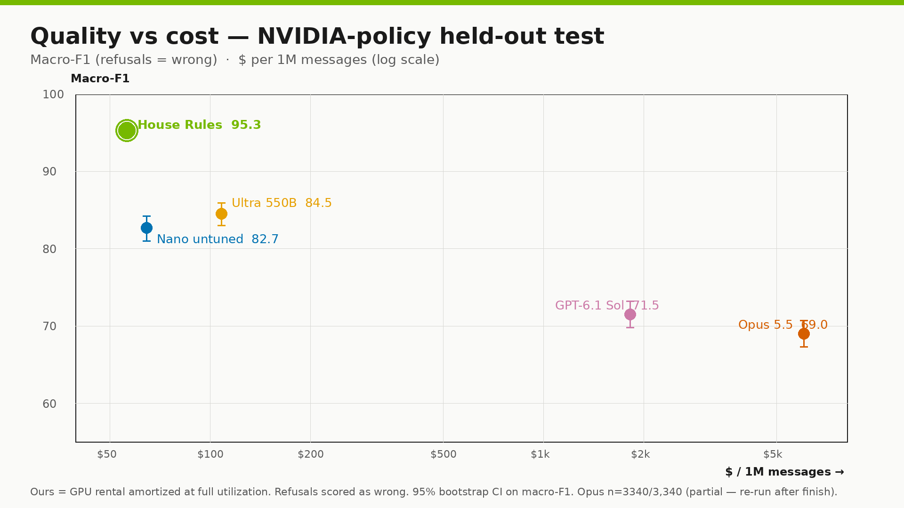
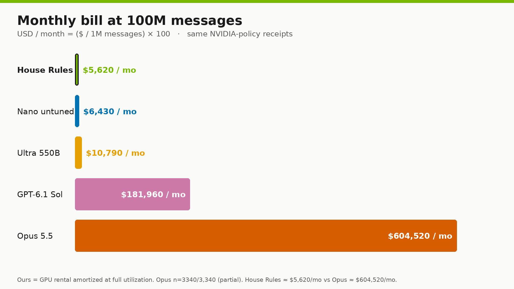
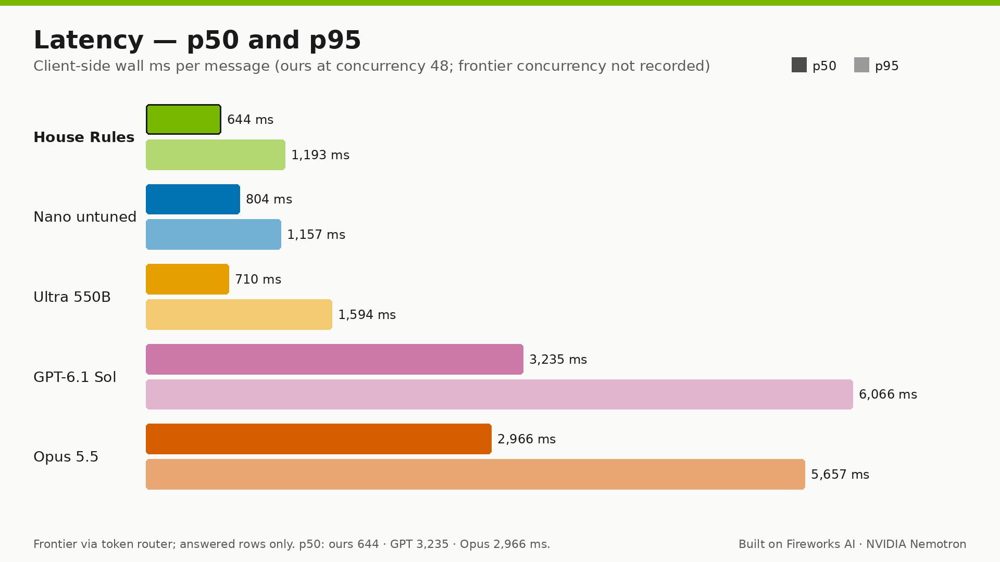
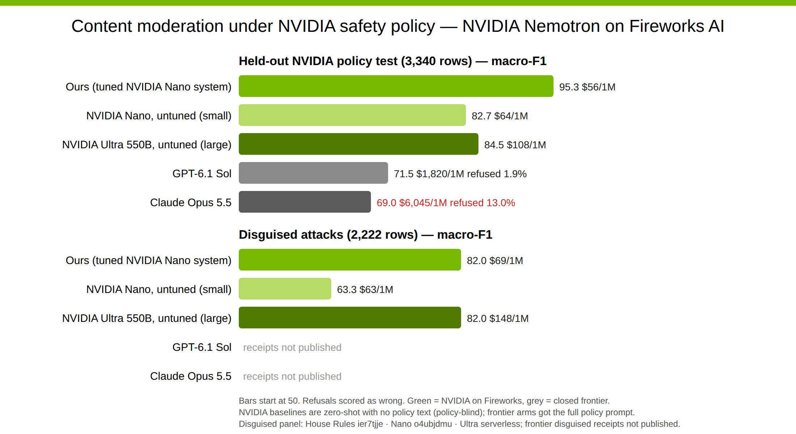
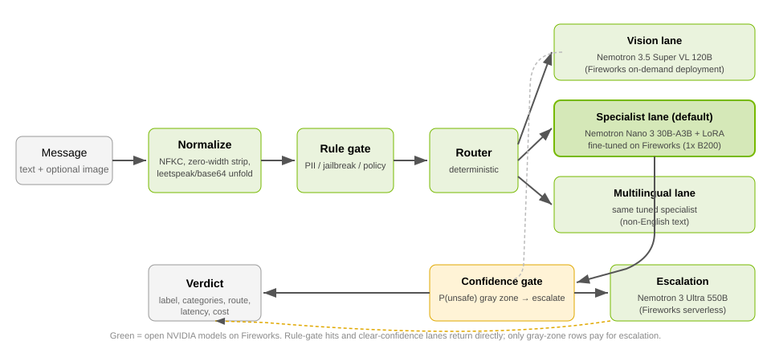

# House Rules

**Your safety policy, enforced.** A content-moderation pipeline built on open
NVIDIA models served by Fireworks. It decides `safe` / `unsafe` under an
explicit, configurable policy — with an auditable route trail, measured
latency, and measured cost per verdict — instead of delegating the decision to
a closed frontier API that applies a policy you don't control and sometimes
refuses to answer at all.


**Built with** Fireworks AI (Training API LoRA SFT, on-demand + serverless
inference) and NVIDIA Nemotron models + data — no endorsement implied.
Full evidence map: **[docs/FIREWORKS_NVIDIA.md](docs/FIREWORKS_NVIDIA.md)**.

**Demo video (< 2 min):** _link coming_ · **Replayable demo:**
`python demo/server.py` → http://127.0.0.1:8787/ (cached receipts, no keys
needed) — see [Demo](#demo).

## Headline — held-out NVIDIA-policy test (n = 3,340)

| System | Macro-F1 | Unsafe recall | Over-block % | Refused % | p50 ms | p95 ms | $/1M msgs |
|---|---:|---:|---:|---:|---:|---:|---:|
| **House Rules** (tuned Nano pipeline) | **95.3** | **97.6** | 5.5 | 0.0 | **644** | **1,193** | **$56** |
| Nemotron Nano 3 30B, untuned | 82.7 | 93.3 | 27.8 | 0.0 | 804 | 1,157 | $64 |
| Nemotron 3 Ultra 550B, zero-shot | 84.5 | 86.7 | **3.3** | 0.0 | 710 | 1,594 | $108 |
| GPT-6.1 Sol | 71.5 | 70.0 | **1.1** | 1.9 | 3,235 | 6,066 | $1,820 |
| Claude Opus 5.5 | 69.0 | 67.6 | 3.9 | 13.0 | 2,966 | 5,657 | $6,045 |

Paired on the same 3,340 rows (refusals scored as errors): **+23.8 macro-F1
over GPT-6.1 Sol** [+22.1, +25.5], McNemar p = 1.1e-169, and **+26.3 over
Claude Opus 5.5** [+24.6, +28.0], p = 7.0e-193 — at **32×** and **108×** lower
marginal cost per message. Details and receipts: [Results](#results) ·
[`results/stats/vs_frontier.md`](results/stats/vs_frontier.md).

## Overview

- **Task.** Binary content moderation (`safe` / `unsafe`, plus taxonomy
  categories) for chat text — an image lane is implemented but not evaluated
  in this submission — scored under NVIDIA's Nemotron-3.5 Content Safety
  policy on held-out data.
- **Intended user.** Product and trust-and-safety teams at message volume —
  chat, social, UGC, AI companions — who need a configurable, auditable
  moderation verdict and can't accept a closed API's fixed policy, refusal
  behavior, tail latency, or per-token pricing.
- **Approach.** Deterministic clean-up and rules first; a small fine-tuned
  open model second; an expensive model only for the gray zone. A message is
  normalized (obfuscation unfolds), screened by a rule gate, routed by content
  type to a specialist, and escalated only when the specialist is uncertain
  (3.2% of on-policy rows).
- **Why it matters.** Moderation is a marginal cost on every message, so the
  gap is decisive at scale: at 100M messages/month the bill is **~$9.8K**
  for one always-on House Rules GPU vs **~$182K** on GPT-6.1 Sol or
  **~$605K** on Claude Opus 5.5 — while scoring higher, refusing **0%** of
  requests, and logging every verdict's route, model, and cost for audit.
  (Below ~5M msgs/month pay-per-token is cheaper — see the
  [monthly bill](#nvidia-policy-held-out-test-n--3340).) Fine-tuning a 30B
  open model on the target policy beat the same model untuned by **+12.6
  macro-F1** and a 550B zero-shot model by **+10.8** on 3,340 held-out cases,
  at roughly half the cost per message — with the caveat that both NVIDIA
  baselines ran *policy-blind* (a minimal prompt with no policy text; see
  [Method](#results)). Teams adopt this to own their policy, eliminate
  refusal-as-product-failure, and keep safety spend flat as volume grows.

## Built with — sponsor technology, with receipts

Every claim below cites a receipt in this repo;
[docs/FIREWORKS_NVIDIA.md](docs/FIREWORKS_NVIDIA.md) is the full evidence map.

| What ran | Fireworks surface | NVIDIA model / asset | Receipt |
|---|---|---|---|
| LoRA SFT of the specialist — rank 8, alpha 32, 1 epoch, lr 1e-4, batch 32 on `data/nvidia/filtered/train_sft.jsonl` (19,830 recipe-input rows — exact consumed count, trainer job id, wall-clock and train cost **not recorded**) | **Training API** — `scripts/train_api_sft.py --job nano` | Nemotron Nano 3 30B-A3B | promoted model `…/models/safety-one-nano-safety` in `results/nvidia-v1/ours_summary.json`, `…/final.jsonl` |
| Tuned specialist + untuned-Nano ablation on dedicated deployments (1× B200 each) | **On-demand deployments** — `scripts/deploy_create.py` | Nemotron Nano 3 30B-A3B (base + LoRA) | deployment ids `qd2gx85j` / `o4ubjdmu` / `ier7tjje` in `results/nvidia-v1/ours_timing.json`, `…/*.jsonl` |
| Large zero-shot baseline + gray-zone escalation target | **Serverless inference** (per-token) | Nemotron 3 Ultra 550B | `results/nvidia-v1/ultra-untuned.jsonl`; escalated rows in `results/nvidia-v1/final.jsonl` |
| Train + held-out eval data | — | Nemotron-3.5 Content Safety Dataset (CC-BY-4.0); Aegis 2.0 test subset | `data/nvidia/manifest.json`, `data/README.md` |
| Vision lane for image routing | **Wired + deploy script; no evaluated run shipped** | Nemotron 3.5 Super VL 120B (on-demand) | `scripts/vision_deploy.sh`, `config/router.yaml` |

**Microsoft:** no Microsoft services are used.

## Results

**Method.** Every system ran the same rows under the same deterministic
scorer. The prompts differ **by design**, disclosed here rather than claimed
identical:

- **House Rules (tuned specialist)** — its one-line training prompt
  (`scripts/nano_ladder.py` `TRAIN_SYSTEM_PROMPT`: "…using the project
  taxonomy"). The policy itself is learned from the LoRA training data, not
  written into the prompt.
- **Untuned Nano and Ultra zero-shot baselines** — the minimal label-only
  prompt in `safety_one/providers/fireworks.py` ("Classify the user content
  for content safety…"), **with no policy text**: ≈83–93 median prompt
  tokens across the shipped receipts. These NVIDIA zero-shot baselines are
  therefore *policy-blind*, and their gap to House Rules mixes fine-tuning
  with policy knowledge (see
  [Limitations](#tradeoffs-and-limitations)).
- **GPT-6.1 Sol and Claude Opus 5.5** — the full shared policy + 26-category
  taxonomy prompt (`safety_one/providers/frontier.py` `moderation_prompt()`),
  ≈390 (GPT tokenizer) / ≈725 (Opus tokenizer) extra input tokens per
  message vs the NVIDIA arms, driven by
  `baselines/run_frontier_router.py`.

The headline metric is binary macro-F1 over `safe`/`unsafe`, reported with
unsafe recall, over-block rate (share of gold-`safe` rows blocked), refusal
rate, p50/p95 latency, and USD per 1M messages. Provider refusals and errors
are scored as incorrect. Differences use paired bootstrap 95% CIs and exact
McNemar tests on id-matched rows (`results/nvidia-v1/ours_summary.json`,
`results/stats/vs_frontier.json`).

**Datasets.**

- `nvidia_test` — 3,340 held-out rows from NVIDIA's Nemotron-3.5 Content
  Safety test split (`data/nvidia/test.jsonl`): 590 English + 2,750
  non-English rows across 11 languages. Never trained or calibrated on.
- `disguised_v1` — 2,222 rows (`data/frozen/disguised_v1.jsonl`): **300 base
  messages** (150 unsafe / 150 safe, seed 20261102) × **7 obfuscation
  perturbations** (base64 wrap, char-spacing, emoji substitution, homoglyphs,
  leetspeak, mixed case, zero-width chars) plus the unperturbed control
  (`none`). Gold labels come from each row's **source dataset policy** — six
  mixed-policy sources (NVIDIA Nemotron-3.5 CS, Aegis 2.0, OpenAI Moderation,
  XSTest, HatemojiCheck, WildGuardTest) — so this is a cross-policy
  robustness set, not a second NVIDIA-policy set. 320 WildGuard-derived rows
  ship redacted (stable row ids; scored from receipts). Because variants of
  one base message are correlated, the row-level CIs below are paired with
  clustered by-base-message CIs (300 clusters, 2,000 resamples, seed 0) and a
  seeded paired cluster randomization test (10,000 permutations, two-sided) in
  [`results/stats/disguised_clustered.md`](results/stats/disguised_clustered.md)
  — the primary significance check on this set; row McNemar is kept as a
  labeled diagnostic. The intervals widen — e.g. ours − Ultra is −0.0
  [−2.9, +2.8] clustered, rand p = 0.99, vs [−1.6, +1.6] row-level — and
  every conclusion is unchanged. House Rules' `disguised_v1` receipts are
  from an earlier run of the same adapter on deployment `ier7tjje`;
  Ultra is serverless per-token, with no dedicated deployment, while
  Nano untuned's receipts ran later on `o4ubjdmu`.
  The frontier receipts from that earlier run were not retained — see the
  footnote under the disguised table.

### NVIDIA-policy held-out test (n = 3,340)

The headline table at the top is this set. Two more facts:

- Non-English slice (n = 2,750, 11 languages): House Rules holds at **95.9
  macro-F1 / 98.6 unsafe recall**; the untuned Nano drops to 81.3 and
  zero-shot Ultra to 81.8 (`results/nvidia-v1/ours_summary.json`).
- Refusals (scored as errors): GPT-6.1 Sol refused **1.9%** (62) of these
  requests; Claude Opus 5.5 refused **13.0%** (434). House Rules and both
  NVIDIA baselines answered 100% of rows.

**Monthly bill** — two honest bases, both computed from receipts (see cost
method below):

- **Marginal rate at saturation** ($/1M msgs, from the unrounded figures
  56.2 / 64.3 / 107.9 / 1,819.6 / 6,045.2 in `results/nvidia-v1/ours_summary.json`
  and `results/stats/vs_frontier.json`): ours **$56**, Nano untuned $64,
  Ultra zero-shot $108, GPT-6.1 Sol $1,820, Claude Opus 5.5 $6,045. Ours =
  dedicated-GPU rental ($13/h, 1× B200) amortized at **full utilization**
  over measured run wall-clock ÷ model calls (concurrency 48), plus measured
  Ultra escalation tokens; spin-up/idle excluded. Frontier $/1M = (receipt
  cost of verdict rows + `results/spend.json` ledger cost of refusal rows) ÷
  all 3,340 rows; GPT refusals are HTTP-level blocks billed at $0 —
  conservative in GPT's favor.
- **Always-on bill.** A real service can't batch a month of traffic into 4
  GPU-hours: one dedicated B200 at $13/h costs **≈$9,490/month** ($13 × 730
  h) whether it serves 1 message or 178M, plus $2.87/1M of Ultra escalation
  token spend (`final` token_usd $0.0096 ÷ 3,340 rows).

| Messages/mo | House Rules, always-on 1× B200 | Nano untuned, always-on 1× B200 | Ultra zero-shot, serverless | GPT-6.1 Sol | Claude Opus 5.5 | Honest result |
|---|---:|---:|---:|---:|---:|---|
| 1M | $9,493 | $9,490 | $108 | $1,820 | $6,045 | Ultra cheapest; **GPT is 5.2× cheaper** than ours, Opus 1.6× |
| 10M | $9,519 | $9,490 | $1,079 | $18,196 | $60,452 | Ultra cheapest; ours 1.9× cheaper than GPT, 6.4× than Opus |
| 100M | $9,777 | $9,490 | $10,790 | $181,964 | $604,524 | ours ≈ Nano's GPU floor, below Ultra; 18.6× / 61.8× cheaper than GPT / Opus |

Break-even: always-on House Rules beats GPT-6.1 Sol above **≈5.2M msgs/mo**
and Opus 5.5 above **≈1.6M msgs/mo** ($9,490 ÷ per-1M price gap); below
that, pay-per-token wins. The same GPU floor applies to the untuned-Nano arm
(its own dedicated deployment, no escalation tokens). A zero-shot
Ultra-550B-only service has no GPU floor and stays cheaper than always-on
House Rules up to **≈90M msgs/mo** ($9,490 ÷ ($107.9 − $2.87)/1M). One B200
replica at the measured rate (3,340 calls in 49.3 s ≈ 68 msg/s, concurrency
48) serves ≈178M msgs/month, so 100M/mo is ≈56% average utilization; HA or
peak headroom means a second replica (+$9,490/mo). Fireworks deployment
autoscaling / scale-to-zero would soften the floor for bursty traffic — it
was **not measured** here.



*Quality vs cost on the 3,340-row held-out test, refusals scored as wrong
(Opus refused 13.0%, GPT 1.9%).*



*Monthly bill vs volume (log–log): the always-on GPU floor keeps House Rules
≈$9.5–9.8K at every volume — $9,777 at 100M — while token-billed GPT and
Opus grow linearly to $182K / $605K and serverless Ultra stays cheaper below
≈90M msgs/mo. See the table above.*



*Client-side wall-time latency, p50 and p95 (frontier latency over answered
rows only).*

### Disguised attacks (n = 2,222)

| System | Macro-F1 | Unsafe recall | Over-block % | Refused % | p50 ms | p95 ms | $/1M msgs | Marginal bill 1M / 10M / 100M per mo |
|---|---:|---:|---:|---:|---:|---:|---:|---|
| House Rules | 82.0 | **89.4** | 25.3 | 0.0 | **571** | **1,115** | $69 | $69 / $692 / $6,920 |
| Nemotron Nano 3 30B, untuned | 63.3 | 94.0 | 62.2 | 0.0 | 775 | 1,086 | $63 | $63 / $627 / $6,270 |
| Nemotron 3 Ultra 550B, zero-shot | 82.0 | 83.8 | 19.9 | 0.0 | 713 | 1,013 | $148 | $148 / $1,484 / $14,840 |

Every metric cell above is computed from shipped receipts
(`results/nvidia-v1/ours_summary.json`); the House Rules $/1M additionally
assumes the earlier run's GPU allocation from retained metadata — its timing
file is not shipped (see Ablations). The bill column repeats the marginal
at-saturation rate; for an always-on dedicated deployment, replace the
amortized GPU allocation with the ≈$9,490/mo floor described above, then add
token spend (Ultra is serverless — no floor).

> **Frontier models on disguised_v1 — earlier run, per-case receipts not
> published** (not verifiable from this repo; excluded from all asserted
> numbers): GPT-6.1 Sol scored 87.8 macro-F1 (recall 81.8, over-block 6.0,
> refused 0.3%) and Claude Opus 5.5 scored 64.8 (refused 28.8%). House
> Rules' and Ultra's disguised_v1 rows were recorded in that same earlier
> run and are shipped; the frontier receipts from it were not retained.
> Taken at face value, GPT-6.1 Sol beats House Rules on disguised text — see
> [Limitations](#tradeoffs-and-limitations).

### Paired differences (House Rules − baseline, macro-F1 points)

| Baseline | Dataset | Δ | 95% CI | McNemar p |
|---|---|---:|---|---:|
| Nemotron Nano 30B untuned | nvidia_test | **+12.6** | [+11.0, +14.4] | 3.5e-49 |
| Nemotron 3 Ultra 550B zero-shot | nvidia_test | **+10.8** | [+9.4, +12.4] | 2.5e-54 |
| GPT-6.1 Sol | nvidia_test | **+23.8** | [+22.1, +25.5] | 1.1e-169 |
| Claude Opus 5.5 | nvidia_test | **+26.3** | [+24.6, +28.0] | 7.0e-193 |
| Nemotron Nano 30B untuned | disguised_v1 | **+18.7** | [+16.5, +20.8] | 7.8e-55 |
| Nemotron 3 Ultra 550B zero-shot | disguised_v1 | −0.0 | [−1.6, +1.6] | 0.96 |
| Pipeline − clean-up step (ablation) | disguised_v1 | **+8.0** | [+6.4, +9.7] | 8.7e-21 |
| Pipeline − specialist-only ablation | nvidia_test | +0.2 | [−0.4, +0.7] | 0.73 |

NVIDIA-baseline rows: `results/nvidia-v1/ours_summary.json`
(`paired_vs_final`, 1,000 resamples). Frontier rows:
`results/stats/vs_frontier.json` / `vs_frontier.md` (10,000 resamples, seed 0,
refusals scored as wrong; GPT 764/45 and Opus 844/44 discordant wins/losses).
Disguised rows above are row-level CIs; the clustered by-base-message
intervals and seeded cluster randomization p-values (10,000 permutations;
primary significance check, row McNemar is a labeled diagnostic) in
[`results/stats/disguised_clustered.md`](results/stats/disguised_clustered.md)
are wider but reach the same conclusions: ours − Ultra −0.0 [−2.9, +2.8],
rand p = 0.99 — no detected difference; ours − Nano untuned +18.7 [+14.1, +23.4],
rand p ≤ 1e-4; ours − clean-up-off +8.0 [+5.9, +10.1], rand p ≤ 1e-4.

Secondary metrics vs frontier (`results/stats/vs_frontier.md`): Δ unsafe
recall **+27.7** [+25.9, +29.4] vs GPT and **+30.0** [+28.2, +31.8] vs Opus.
**Disclosed loss:** we over-block more than GPT-6.1 Sol — **+4.4 pp** [+2.5,
+6.3], significant — and insignificantly more than Opus (+1.6 [−0.5, +3.7]).

**Refusals-excluded robustness check.** The win does not depend on scoring
refusals as errors. Recomputing macro-F1 on only the rows each frontier model
actually answered (same receipts): GPT-6.1 Sol **73.0** vs ours **95.3**
(n = 3,278); Opus 5.5 **80.6** vs ours **95.4** (n = 2,906).

**Route breakdown** (nvidia_test, from `results/nvidia-v1/final.jsonl`):

| Route | n | Share | Macro-F1 |
|---|---:|---:|---:|
| multilingual | 2,677 | 80.1% | 97.1 |
| multilingual › escalation | 73 | 2.2% | 67.1 |
| specialist | 556 | 16.6% | 95.0 |
| specialist › escalation | 34 | 1.0% | 54.7 |
| rule | 0 | — | — |

Escalated rows are the hard ones (68.2% accuracy) — the gray-zone lane is
doing its job by absorbing them without dragging down the cheap lanes.

**Ablations.** Removing normalization (clean-up) costs **+8.0 macro-F1** on
disguised attacks — base64-wrapped unsafe recall collapses to 0.7%. The
specialist-only ablation (no rules, router, or escalation) is **+0.2** [−0.4,
+0.7], n.s. on-policy: the full pipeline's evidenced exchange there is
over-block **7.3 → 5.5%** in return for lower recall (98.0 → 97.6), higher
cost ($52.2 → $56.2/1M) and a worse tail (p95 944 → 1,193 ms). No
specialist-only run on `disguised_v1` is shipped, so escalation's value on
adversarial inputs is **unverified**. The tuned arm exceeds the policy-blind
untuned Nano arm by **+12.6** on-policy and **+18.7** disguised; this
comparison does not isolate fine-tuning from policy access. The clean-up
ablation is cross-run: `final`'s disguised rows come
from the earlier run on deployment `ier7tjje` while `final-rawtext` ran
later on `qd2gx85j` with the current code (only `provider_text` differs);
the $69/1M disguised rate assumes the earlier run's GPU allocation ($60/1M
calls) from retained metadata — its timing file is not shipped.



*Headline across all five systems and both datasets; frontier disguised-attack
cells carry no published receipts.*

### Sources

All numbers are computed from run receipts, not mocks:

- `results/nvidia-v1/ours_summary.json` + `OURS_SUMMARY.md` — House Rules +
  NVIDIA baselines, all slices, paired tests (`scripts/nvidia_summary.py`
  regenerates for $0).
- `results/nvidia-v1-frontier/frontier-router-{a,b}.jsonl` — per-case frontier
  receipts for the NVIDIA-policy test (3,340 rows each).
- `results/stats/vs_frontier.{json,md}` — frontier paired stats
  (`scripts/stats_vs_frontier.py` regenerates for $0).
- `results/stats/disguised_clustered.md` — clustered by-base-message CIs for
  the disguised set.
- `results/spend.json` — spend ledger: per-row billed cost for Opus refusal
  rows (368 of 434 refusals billed, $1.67 total; the rest and all GPT refusals
  carry no billed cost, counted at $0 — conservative in GPT's favor).
- `results/nvidia-v1/final_headline.json` — aggregated table
  (`scripts/final_headline.py` regenerates for $0). Its frontier
  `disguised_v1` cells are `null` — those receipts were never published.
- `results/nvidia-v1/ours_timing.json` — GPU-allocation inputs for $/1M.

**Cost method.** $/1M messages = measured per-token spend in the receipts +
allocated dedicated-GPU time: $13/h (1× B200) × measured run wall-clock ÷
model calls in that run, at concurrency 48. Deployment spin-up and idle time
are excluded, so dedicated-GPU costs assume full utilization (see
Limitations). Frontier costs are billed API spend: measured receipt cost of
verdict rows plus the spend-ledger cost of refusal rows, over all rows.
Latency is client-side wall time per message including queueing and
escalation round-trips (frontier latency over answered rows only).

**Frontier access path.** Both frontier arms ran through a third-party
OpenAI-compatible token router (`baselines/run_frontier_router.py`), billed
at the router's published rates — a ratio-priced gateway, not first-party
list prices (`baselines/prices.yaml`, fetched 2026-11-02: GPT-6.1 Sol $2 /
$10 and Claude Opus 5.5 $4 / $20 per 1M input / output tokens). The run's
`--concurrency` flag was not recorded (runner default: 4; the NVIDIA runs
used 48), and frontier latency includes the gateway hop. On answered rows,
GPT averaged 539 input / 78 output tokens per message and Opus 923 / 134;
≈390 / 725 of those input tokens are the policy prompt that the tuned
specialist does not need.

## Architecture



1. **Normalize (stage 0).** Unicode NFKC, zero-width removal, conservative
   leetspeak/confusable folding, bounded base64/ROT13 decode. The original
   text is always retained; the model sees the normalized view. This step is
   worth **+8.0 macro-F1** on disguised attacks — with it off, unsafe recall
   on base64-wrapped input collapses to 0.7%.
2. **Rule gate.** Deterministic PII / jailbreak / policy-pattern checks. A
   high-confidence hit short-circuits to a verdict (no NVIDIA-test row was
   rule-decided; the gate mostly matters for obvious cases and audit).
3. **Router.** Deterministic routing on content type: image or emoji-dense →
   vision lane; non-English → multilingual lane; otherwise → specialist.
4. **Specialist.** NVIDIA Nemotron Nano 3 30B-A3B with a LoRA adapter —
   rank 8, alpha 32, 1 epoch, lr 1e-4, batch 32 on
   `data/nvidia/filtered/train_sft.jsonl` (19,830 input rows), per the
   `scripts/train_api_sft.py --job nano` recipe on the Fireworks Training API;
   the count the trainer actually consumed, the job id, wall-clock and cost
   were **not recorded** —
   served on a dedicated Fireworks deployment (1× B200). `config/train.yaml`
   is the earlier draft for the unused managed-SFT path. The multilingual
   lane uses the same tuned model; the vision lane is a Nemotron 3.5 Super VL
   120B on-demand deployment (not evaluated in this submission).
5. **Confidence gate.** If P(unsafe) lands in the gray zone (default
   [0.35, 0.65], widened per high-stakes category), the row escalates to
   **Nemotron 3 Ultra 550B** on Fireworks serverless. Only 3.2% of
   NVIDIA-policy rows and 9.8% of disguised rows escalate — the rest pay the
   small model's price.

Every verdict carries `{label, categories, route, rule_hits, model, latency,
cost}` — an auditable path for each decision.

## Bring your own policy

The shipped numbers are scored under NVIDIA's Nemotron-3.5 policy; the
pipeline is not married to it.

**Without retraining — config only** (`config/router.yaml`):

```yaml
confidence_gate:
  gray_zone:
    default: [0.35, 0.65]          # widen -> escalate more borderline rows
    category_overrides:
      sexual_minor: [0.05, 0.95]   # near-always escalate this category
```

Moving `calibration.unsafe_threshold` or the gray-zone band changes verdicts
on the *same* specialist scores — the demo's threshold slider re-scores the
cached P(unsafe) values live with no model call. Route rules
(`route_order`, `emoji_route`, `non_english_route`) and the rule-gate
patterns are declarative too.

**With retraining — a new policy needs labeled data and a LoRA pass:**

1. Label rows under the new taxonomy (`scripts/prep_nvidia.py`-style; the
   shipped adapter's recipe input was 19,830 train + 2,479 dev rows; the count
   actually consumed was **not recorded**).
2. `python scripts/train_api_sft.py --job nano` — the shipped adapter's
   recipe on the Fireworks Training API; its wall-clock and cost were
   **not recorded**.
3. `scripts/deploy_create.py` → dedicated deployment, then
   `scripts/calibrate_gate.py` re-fits the threshold and gray zone on a dev
   split.
4. Re-run `scripts/run_eval.py` + `scripts/nvidia_summary.py` for receipted
   numbers under the new policy.

**Integration contract** — one auditable verdict per message (real row from
`results/nvidia-v1/final.jsonl`):

```json
{"label": "unsafe", "categories": ["misinformation"], "route": "specialist",
 "rule_hits": [], "model": "accounts/…/deployments/qd2gx85j",
 "latency_ms": 1303.99, "cost_usd": 0.0}
```

(`cost_usd` is per-token spend; dedicated-GPU time is allocated per run —
see the cost method above.)

## Demo

`demo/` is a loopback "moderation race": 100 fixed cases classified by House
Rules and GPT-6.1 Sol side by side, then replayable from cached receipts
(`demo/cached/` — `python demo/server.py`, no keys; `--live` re-runs with
keys).

Read the meters the right way:

- **Raw demo spend looks worse for us, and it's real:** $0.2809 vs $0.1541
  for 100 messages ($2,809 vs $1,541 per 1M) — ours is the *allocated
  per-verdict* cost; the dedicated GPU's rental over the whole ~79 s window
  was $0.2862 (rule-decided rows carry no per-verdict allocation, but the
  GPU bills their time too). One dedicated GPU ($13/h) ran ~79 s to serve
  only 100 calls — very low utilization. The **marginal production basis**
  in the tables above —
  full-utilization amortization measured on the 3,340-row runs — is **$56 vs
  $1,820 per 1M** (`results/stats/vs_frontier.json`), with the always-on GPU
  floor replacing amortized GPU allocation as shown in the bill table.
  These numbers measure different things.
- **The p95 tail is Ultra escalation, not the specialist:** ours p50
  **178 ms** vs GPT 2,532 ms, but p95 **11,300 ms** vs 5,659 ms because 7/100
  demo rows escalated to Ultra serverless (11–35 s each, cold/queued). Every
  non-escalated row finished in ≤ 425 ms, and production p95 on 3,340 rows is
  1,193 ms vs GPT's 6,066 ms.
- **Accuracy:** 97 vs 91 of 100 correct.

## Tradeoffs and limitations

- **Disguised attacks are the weak spot — GPT-6.1 Sol beat us there in an
  earlier run** whose per-case receipts are not published (87.8 vs 82.0
  macro-F1; unverifiable here, see the footnote under the disguised table).
  Zero-shot Ultra ties us on disguised text (paired Δ −0.0, row-level CI
  [−1.6, +1.6], clustered by-base-message CI [−2.9, +2.8], cluster
  randomization p = 0.99 in `results/stats/disguised_clustered.md` — same
  conclusion). House
  Rules gets higher unsafe recall (89.4 vs 81.8/83.8) at the price of
  over-blocking one in four safe disguised rows (25.3%). If your traffic is
  mostly adversarial text and recall-tolerant, the frontier model may be the
  better fit.
- **Over-block is the price of recall.** 5.5% on-policy, 25.3% under
  disguise. We over-block significantly more than GPT-6.1 Sol on-policy
  (+4.4 pp [+2.5, +6.3]) — that's the disclosed cost of 97.6% unsafe recall.
  The headline run used the model's generated label
  (`calibration.unsafe_threshold: null` in `config/router.yaml`) and the
  default gray-zone band, which the config itself marks as placeholder.
  Dev-fitted variants (`specialist-cal` / `full-cal` in
  `config/systems.yaml`, fitted by `scripts/calibrate_gate.py` maximizing
  dev **macro-F1**, not recall) exist but are not what produced the shipped
  receipts; threshold and gray zone are config, not constants.
- **Dedicated capacity has a floor.** The $56/1M rate amortizes $13/h over
  measured run wall-clock at concurrency 48 and excludes spin-up/idle. An
  always-on deployment costs ≈$9,490/month regardless of volume, so below
  ≈5.2M msgs/mo GPT-6.1 Sol is the cheaper option (see the monthly-bill
  table), and the raw spend at very low traffic is far worse: the same
  pipeline shows $2,809/1M on the 100-call demo.
- **One policy.** Scores are under NVIDIA's content-safety taxonomy. Other
  labs' policies differ (the disguised set's own labels come from six
  mixed-policy sources); the same system under another policy needs
  re-labeled data and a re-tuned threshold — the pipeline supports it (see
  [Bring your own policy](#bring-your-own-policy)), the measured numbers
  don't transfer.
- **Baseline prompts are asymmetric (disclosed, not corrected).** The
  untuned-Nano and Ultra zero-shot baselines ran the minimal label-only
  prompt and never saw the written policy, while the frontier arms saw the
  full ≈390–725-token policy prompt (see Method). So "+12.6 over untuned
  Nano" and "+10.8 over Ultra 550B" mix fine-tuning with policy knowledge —
  a policy-prompted Ultra could score higher than 84.5 (untested). Re-running
  the NVIDIA baselines with the policy prompt is a paid run and was not
  done; the asymmetry is disclosed here instead of re-benchmarked.
- **Frontier baselines are zero-shot.** Both ran the full shared policy +
  26-category taxonomy prompt with no few-shot examples and no policy
  fine-tuning — the only arms shown the written policy (see Method). A
  fine-tuned or few-shot frontier arm could score higher (untested); the
  comparison demonstrates the cost / latency / refusal trade-off, not the
  best achievable frontier score.
- **Opus refusal rate.** Claude Opus 5.5 completed all 3,340 NVIDIA-policy
  rows but refused to classify 13.0% of them (28.8% of disguised rows in the
  earlier run); refusals are scored as incorrect. The refusal rate is itself
  the finding — and the refusals-excluded check above shows it isn't what
  wins for us.
- **Escalation adds little on-policy** (+0.2 macro-F1 [−0.4, +0.7], p = 0.73,
  escalating 3.2% of rows). The evidenced exchange is over-block 7.3 → 5.5%
  in return for lower recall (98.0 → 97.6), higher cost ($52.2 → $56.2/1M)
  and a worse p95 tail (944 → 1,193 ms) vs specialist-only. Whether it pays
  off on adversarial or mixed-policy inputs is **unverified** — no
  specialist-only `disguised_v1` run is shipped.
- **Human review.** This is a moderation component, not a trust-and-safety
  program; high-impact decisions still need appeal and human review paths.
- **Vision lane.** Image routing is implemented and unit-tested
  (`tests/test_router.py`, `tests/test_vision_live.py`), but no image was
  classified by the vision lane in any shipped receipt — including the demo,
  where the only image case routed to the text specialist. The Super VL
  deploy script exists (`scripts/vision_deploy.sh`); no evaluated run is
  shipped, so no vision score is claimed.
- Untuned Nano produced an unparseable label on 12/5,562 rows (1 on
  nvidia_test, 11 on disguised_v1 — counted incorrect); all other reported
  runs had zero provider errors.

## Setup

Requires Python 3.12. The test suite, the offline eval, the receipt
regeneration scripts, the notebook, and the replay demo make **no paid
calls**.

```bash
python3.12 -m venv .venv
source .venv/bin/activate
pip install -r requirements.txt
cp .env.example .env        # fill in keys for live runs only
python -m pytest -q         # 352 tests, all offline
```

## Reproduce

The first three blocks are **$0 and offline**: the scripts read the shipped
receipts in `results/` and make no network calls. Only re-running models —
evals, training, deployments, `--live` demo, frontier baselines — needs
`FIREWORKS_API_KEY` / `FIREWORKS_ACCOUNT_ID` / `ROUTER_*` keys from `.env`.

```bash
# Offline eval on bundled fixtures + mock arms ($0)
python scripts/run_eval.py

# Recompute every reported number from receipts ($0, no model calls)
python scripts/nvidia_summary.py            # -> results/nvidia-v1/ours_summary.json (+ table to stdout)
python scripts/final_headline.py            # -> results/nvidia-v1/final_headline.json
python scripts/stats_vs_frontier.py         # -> results/stats/vs_frontier.{json,md}
python scripts/stats_disguised_clustered.py # -> results/stats/disguised_clustered.{json,md}

# Replay the demo (cached receipts, $0) / go live with keys
python demo/server.py                  # http://127.0.0.1:8787/
python demo/server.py --live           # real calls, needs keys

# Recreate the headline arm on the prepared datasets (live; needs .env keys)
export FIREWORKS_API_KEY=...                                   # live calls
export FIREWORKS_MODEL=accounts/<acct>/deployments/<id>        # tuned-Nano deployment
python scripts/run_eval.py \
  --data data/nvidia/test.jsonl \
  --data data/frozen/disguised_v1.jsonl \
  --system final=scripts.nano_ladder:full \
  --out results --run myrun --concurrency 48
```

`scripts.nano_ladder:full` is the factory the shipped `final` receipts used:
same `full` wiring as the registry, but the specialist/multilingual roles get
the one-line training prompt + compact-label parser the LoRA was trained on,
and emoji-dense text routes to the text specialist (every eval row is
text-only). A generic `--system full=safety_one.registry:full` arm instead
uses the shared provider prompt — a different input distribution, not the
headline arm. The untuned-Nano baseline is `scripts.nano_ladder:nano-untuned`
with `NANO_BASE_MODEL` set to the base deployment; see
`config/systems.yaml` for the rest of the registry ladder.

Frontier router arms are driven by `baselines/run_frontier_router.py`
(`ROUTER_BASE_URL`, `ROUTER_API_KEY`, `FRONTIER_MODEL_{A,B}`). Training/deploy
recipes live in `scripts/train_api_sft.py` (Training API path used for the
shipped adapter — needs the optional training-cookbook install described in
[docs/FIREWORKS_NVIDIA.md](docs/FIREWORKS_NVIDIA.md), not in
`requirements.txt`), `scripts/train_launch.sh` (managed-SFT draft, not used),
`scripts/deploy_create.py`, and `scripts/vision_deploy.sh`; data preparation
in `scripts/prep_*.py`. See `config/systems.yaml` for the full system registry
(pipeline ladder `+rules` → `+router` → `+escalation`/`full`, single-provider
baselines) and `demo/README.md` for live-mode details.

Note: scripts that default to `results/frozen-v1` (`scripts/finalize.sh`,
`scripts/make_report.py`, `scripts/refusal_incorrect.py`,
`scripts/nano_summary.py`, `baselines/* --run`, `demo/record.py`) regenerate
an earlier internal run whose receipts are not published. The shipped
receipts are `results/nvidia-v1/`, `results/nvidia-v1-frontier/`,
`results/spend.json`, and `results/stats/`.

## Reproduce in a notebook

`notebooks/house_rules_eval.ipynb` is a keyless, top-to-bottom demonstration:
it reloads the run receipts in `results/nvidia-v1/` and
`results/nvidia-v1-frontier/`, recomputes every headline number above with the
repo's own scoring code (`safety_one.eval.metrics`,
`scripts/nvidia_summary.py`), and **asserts each one matches this README** —
quality/cost/latency charts, a monthly-bill table at 1M–100M messages, the
per-route breakdown, real example rows (errors included), and one optional
live-classification cell that is skipped unless `FIREWORKS_API_KEY` and
`FIREWORKS_MODEL` are set.

```bash
source .venv/bin/activate
jupyter nbconvert --to notebook --execute --inplace notebooks/house_rules_eval.ipynb
```

## Data and licenses

Code is MIT (see `LICENSE`). Prepared datasets under `data/` keep their
original licenses (NVIDIA Nemotron-3.5 Content Safety CC-BY-4.0, Aegis 2.0
CC-BY-4.0, OpenAI Moderation MIT, WildGuardTest ODC-BY, XSTest CC-BY-4.0,
HatemojiCheck CC-BY-4.0, VLGuard MIT) — see `data/README.md` and
`data/BENCHMARKS.md` for sources, counts, and terms.
